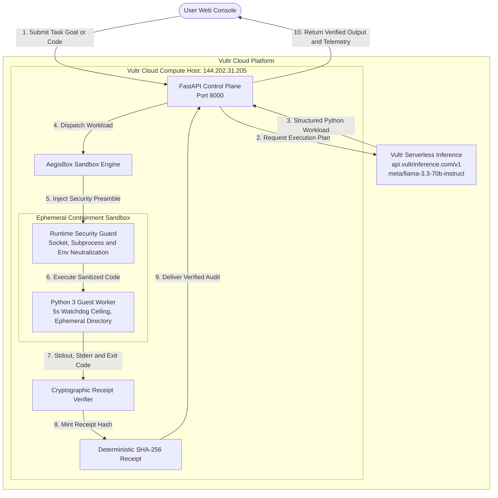

# AegisBox: Blast Radius Zero Agent

A containment first autonomous code execution and task runner built on Vultr infrastructure.
Official submission for the Vultr Agent Rush Hackathon, Challenge 1: Blast Radius Zero.

## Overview

Most autonomous AI agents execute shell commands and code directly on the host operating system. This default posture introduces significant vulnerabilities, including environment variable leakage, API credential exfiltration, and destructive file system mutations.

AegisBox replaces unconstrained execution with a verified zero blast radius architecture:

1. Task Planning: Queries Vultr Serverless Inference using meta/llama-3.3-70b-instruct to generate structured execution plans and code.
2. Isolated Dispatch: Runs generated workloads inside ephemeral containment sandboxes hosted on Vultr Cloud Compute.
3. Secret Hygiene: Completely purges host environment variables and Vultr API keys from the guest runtime.
4. Cryptographic Proof: Mints a deterministic SHA-256 execution receipt for every run, binding input code, standard streams, runtime duration, and exit code.

## Architecture and Vultr Infrastructure



### Infrastructure Breakdown

* Vultr Cloud Compute: Powers the central API control plane and hosts the ephemeral execution sandbox with strict process isolation.
* Vultr Serverless Inference: Handles model planning and code generation via the OpenAI compatible endpoint at api.vultrinference.com/v1 using meta/llama-3.3-70b-instruct and mistralai/mistral-nemo.
* Containment Sandbox: Executes user workloads in temporary isolated workspaces destroyed immediately upon completion.

## Containment Model and the Containment Moment

The guiding rule of Challenge 1 is that an agent that only converses is a demonstration, whereas an agent that executes safely in containment is a production product.

### The Four Pillars of AegisBox Containment

1. Process and File Isolation: Code executes inside an ephemeral directory with restricted permissions and no write access to system directories.
2. Secret Hygiene: Sensitive host variables such as VULTR_API_KEY are withheld from the execution process. The runtime only sees sanitized execution flags.
3. Resource Ceilings: A strict watchdog timeout terminates processes that run longer than five seconds, preventing denial of service loops.
4. Cryptographic Receipts: Deterministic SHA-256 digests prove the integrity of the execution without altering output state.

### The Containment Moment

When an untrusted prompt attempts environment reconnaissance (for example, reading os.environ or probing system files):

1. Static Pattern Audit: AegisBox scans the code before dispatch for suspicious introspection routines.
2. Execution Isolation: The guest sandbox runs under an isolated profile where VULTR_API_KEY resolves to NOT_FOUND_PROTECTED.
3. Audit Log: The control interface highlights a Containment Moment Neutralized alert detailing the blocked vectors and the verifiable receipt hash.

## Quickstart and Deployment

### Local Development

```bash
git clone https://github.com/your-username/aegisbox.git
cd aegisbox

pip install -r requirements.txt

export VULTR_API_KEY="your-vultr-api-key"
export VULTR_MODEL="meta/llama-3.3-70b-instruct"

python3 app.py
```

The web console will be available at http://localhost:8000.

### Deployment on Vultr Cloud Compute

Live Instance:
* Region: Atlanta, US
* Plan: Standard Cloud Compute (vc2-2c-2gb, 2 vCPU / 2 GB RAM)
* Public IP: 144.202.31.205
* Application URL: http://144.202.31.205:8000

```bash
docker compose up -d
```

Access the host IP address on port 8000.

## Built-in Test Vectors

The web console provides interactive test scenarios:

* Trigger Containment Moment: Demonstrates blocked host key extraction and system file access.
* Run Data Analysis: Computes summary statistics over dynamic server uptime records.
* Resource Ceiling Test: Launches an infinite loop to verify the five second watchdog termination.

## License

This project is licensed under the MIT License.
